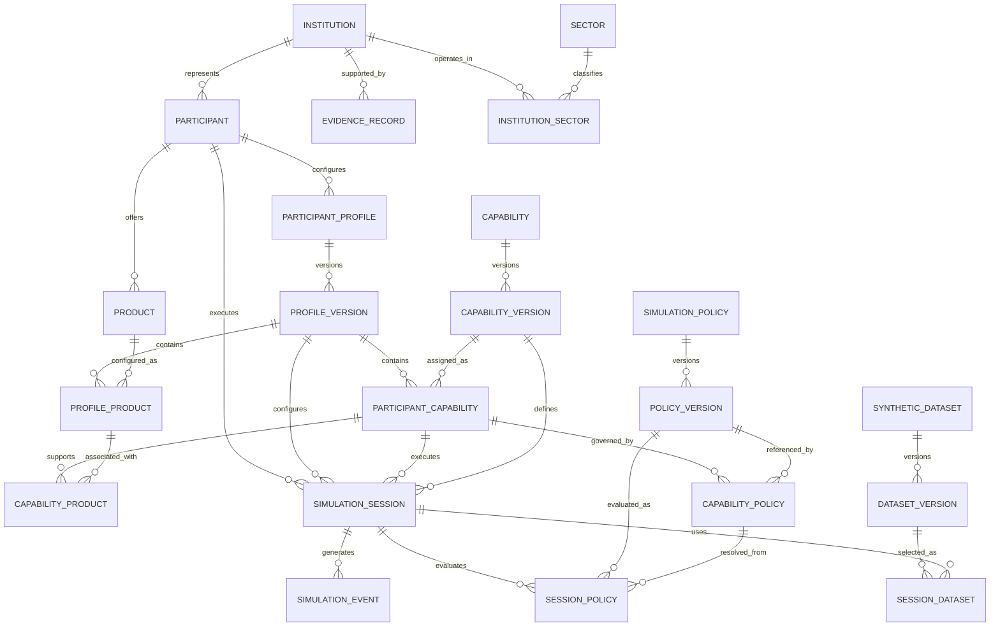

# Domain Data Model

## 1. Purpose

This document defines the conceptual data model for Oquira.

It translates the Participant and Simulation Model into domain entities, attributes, relationships, and lifecycle rules.

The objective is to establish a stable domain foundation before defining database tables, Java classes, API contracts, or migrations.

This is a conceptual model. The exact physical schema remains subject to implementation design.

## 2. Domain Boundaries

The model is divided into two related areas.

### 2.1 Institutional Research Domain

Responsible for representing organizations and their documented real-world information.

It includes:

- Institutional identity.
- Institutional classification.
- Sector membership.
- Source references.
- Evidence records.
- Verification status.
- Historical observations.

### 2.2 Operational Simulation Domain

Responsible for representing actors configured to participate in Oquira experiments.

It includes:

- Participants.
- Participant profiles and versions.
- Products.
- Capabilities.
- Simulation policies.
- Synthetic datasets.
- Simulation sessions.
- Simulation events.

The research domain and operational domain must remain logically separate.

A research record does not automatically become an operational participant.

## 3. Core Entities

### 3.1 Institution

Represents a real-world organization or identifiable financial ecosystem actor.

| Attribute | Description |
|---|---|
| institutionId | Unique internal identifier |
| legalName | Documented legal name, when available |
| displayName | Preferred public-facing name |
| institutionType | Primary institutional classification |
| description | Short institutional description |
| countryCode | Country associated with the institution |
| identityStatus | Status of institutional identity verification |
| createdAt | Record creation timestamp |
| updatedAt | Last update timestamp |

Institutional classification and sector membership should be modeled separately because an organization may operate in multiple sectors.

### 3.2 Sector

Represents a financial ecosystem sector.

Initial examples:

- Banking.
- Cooperatives.
- Payments.
- Fintech.
- Remittances.
- Insurance.
- Pensions.
- Securities and investments.
- Financial infrastructure.
- Identity and trust services.
- Business financial services.
- Emerging financial models.

| Attribute | Description |
|---|---|
| sectorId | Unique identifier |
| code | Stable sector code |
| name | Sector name |
| description | Sector definition |
| status | Active or deprecated |

The sector catalog should be extensible.

### 3.3 InstitutionSector

Associates institutions with sectors.

| Attribute | Description |
|---|---|
| institutionId | Institution reference |
| sectorId | Sector reference |
| relationshipType | Primary, secondary, or other |
| validFrom | Beginning of known relationship |
| validUntil | End date, when applicable |

This relationship allows an institution to participate in multiple financial activities without forcing it into a single category.

### 3.4 EvidenceRecord

Stores references supporting institutional identity, classification, or verification claims.

| Attribute | Description |
|---|---|
| evidenceId | Unique identifier |
| institutionId | Associated institution |
| sourceName | Publisher or issuing organization |
| sourceUrl | Source location |
| sourceType | Official registry, publication, report, or other |
| observedAt | Date the evidence was reviewed |
| publishedAt | Source publication date, when known |
| claimSupported | Description of the claim supported |
| verificationStatus | Pending, verified, disputed, or expired |
| notes | Research notes |

Evidence should be traceable and independently reviewable.

A source record must not imply that every claim about an institution has been verified.

### 3.5 Participant

Represents an actor configured in Oquira.

| Attribute | Description |
|---|---|
| participantId | Unique platform identifier |
| institutionId | Optional associated institution |
| code | Stable internal participant code |
| displayName | Participant name |
| representationType | Verified real, real experimental, or synthetic archetype |
| lifecycleStatus | Draft, active, suspended, or retired |
| description | Purpose and characteristics |
| createdAt | Creation timestamp |
| updatedAt | Last update timestamp |

A synthetic archetype may have no institution reference.

A real institution may be represented experimentally without having an actual technical integration.

### 3.6 ParticipantProfile

Defines a participant's behavior within an experiment or simulation context.

| Attribute | Description |
|---|---|
| profileId | Stable profile identifier |
| participantId | Associated participant |
| profileCode | Profile classification or name |
| description | Profile purpose |
| environment | Development, test, or demonstration |
| currentPublishedVersionId | Reference to active published version |
| createdAt | Creation timestamp |

A participant may have multiple profiles for different scenarios or environments.

Each profile belongs to a defined environment or simulation context. For example, a participant may have a separate profile for testing and another for demonstrations.

Each profile has one current published version. Previous versions remain available for historical reproducibility.

### 3.7 ParticipantProfileVersion

Represents an immutable version of a participant profile.

| Attribute | Description |
|---|---|
| profileVersionId | Unique version identifier |
| profileId | Parent profile |
| versionNumber | Sequential version number |
| configuration | Validated configuration document |
| lifecycleStatus | Draft, published, deprecated, or withdrawn |
| createdAt | Creation timestamp |
| publishedAt | Publication timestamp, when applicable |
| createdBy | Author or responsible system identity |
| changeSummary | Description of changes |

Published versions must not be silently modified.

A change to published configuration creates a new version.

Simulation sessions must reference the exact profile version used during execution.

### 3.8 Product

Represents the stable identity of a financial product or service offered by a participant.

Examples include:

- Checking accounts.
- Savings accounts.
- Credit cards.
- Personal loans.
- Business loans.
- Payment accounts.
- Insurance policies.
- Pension products.
- Investment products.
- Remittance services.

| Attribute | Description |
|---|---|
| productId | Stable unique product identifier |
| participantId | Participant that offers the product |
| productCode | Participant-specific product code |
| name | Product name |
| productType | Shared product classification |
| description | Product description |
| lifecycleStatus | Draft, active, or retired |

Products are participant-specific.

Product identity is separate from its configuration within a published participant profile version. Version-specific product configuration is represented by ParticipantProfileProduct.

### 3.9 Capability

Represents a stable, reusable financial operation or data-access function in the global capability catalog.

| Attribute | Description |
|---|---|
| capabilityId | Stable unique capability identifier |
| code | Stable capability code |
| name | Human-readable name |
| domain | Functional domain |
| description | General functional definition |
| lifecycleStatus | Catalog lifecycle status |

Capability definitions must not be duplicated for individual participants.

The functional contract of a capability is maintained through CapabilityVersion.

### 3.10 CapabilityVersion

Represents an immutable version of a capability definition.

| Attribute | Description |
|---|---|
| capabilityVersionId | Unique version identifier |
| capabilityId | Parent capability |
| versionNumber | Semantic version |
| inputSchema | Expected input structure |
| outputSchema | Expected output structure |
| executionMode | Synchronous or asynchronous |
| requiredPermissions | Required authorization context |
| dependencies | Capability or domain dependencies |
| dataClassification | Applicable data classification |
| lifecycleStatus | Draft, proposed, active, deprecated, or retired |
| publishedAt | Publication timestamp |

A published capability version must remain immutable.

Breaking changes to input, output, or execution semantics require a new major version.

Participant assignments must reference an exact CapabilityVersion.

### 3.11 ParticipantProfileProduct

Associates a product with a specific participant profile version.

| Attribute | Description |
|---|---|
| profileProductId | Unique profile product association |
| profileVersionId | Associated participant profile version |
| productId | Stable product identity |
| configuration | Version-specific product configuration |
| lifecycleStatus | Availability within the profile version |

This entity preserves product configuration as part of the immutable profile version.

A product may have different configurations across participant profile versions.

### 3.12 ParticipantCapability

Associates a capability version with a specific participant profile version.

| Attribute | Description |
|---|---|
| assignmentId | Unique assignment identifier |
| profileVersionId | Participant profile version |
| capabilityVersionId | Exact global capability version |
| availabilityStatus | ENABLED, DISABLED, CONDITIONAL, DEPRECATED, or UNAVAILABLE |
| supportedEnvironments | Supported execution environments |
| configuration | Participant-specific capability configuration |
| requiredPermissions | Required authorization context |
| effectiveFrom | Optional effective date |
| effectiveUntil | Optional expiration date |

The assignment determines whether and under which conditions a profile supports a capability.

The absence of an assignment must never imply support.

Published assignments are immutable because they belong to an immutable profile version.

### 3.13 ParticipantCapabilityProduct

Associates a capability assignment with one or more products available in the same profile version.

| Attribute | Description |
|---|---|
| assignmentId | Capability assignment |
| profileProductId | Product association within the profile version |

A capability may be associated with multiple products.

A capability that is not product-specific may have no product association.

The referenced product association must belong to the same participant profile version as the capability assignment.

### 3.14 SimulationPolicy

Represents the stable identity of a reusable policy governing simulated behavior.

Examples:

- Transaction limits.
- Available balance rules.
- Payment rejection conditions.
- Service availability.
- Response delays.
- Rate limits.
- Credit eligibility scenarios.

| Attribute | Description |
|---|---|
| policyId | Stable unique policy identifier |
| code | Stable policy code |
| name | Policy name |
| policyType | Policy classification |
| description | Policy purpose |
| lifecycleStatus | Draft, active, deprecated, or retired |

Policy identity is independent of its individual rule configurations.

Policy configurations are maintained through SimulationPolicyVersion.

### 3.15 SimulationPolicyVersion

Represents an immutable version of a simulation policy.

| Attribute | Description |
|---|---|
| policyVersionId | Unique version identifier |
| policyId | Parent policy |
| versionNumber | Policy version |
| configurationSchema | Expected configuration structure |
| configuration | Version-specific rule configuration |
| lifecycleStatus | Draft, published, deprecated, or retired |
| publishedAt | Publication timestamp |

Published policy versions must remain immutable.

A simulation must preserve the exact policy versions evaluated during execution.

### 3.16 ParticipantCapabilityPolicy

Associates policy versions with participant capability assignments.

| Attribute | Description |
|---|---|
| assignmentId | Capability assignment |
| policyVersionId | Exact policy version |
| evaluationOrder | Optional policy evaluation priority |
| configurationOverrides | Validated assignment-specific parameters, when permitted |

A capability assignment may reference multiple policies.

Policy references must identify exact versions.

Policy evaluation remains the responsibility of the Policy Evaluator, not the capability definition.

### 3.17 SyntheticDataset

Represents the stable identity of a controlled collection of synthetic financial data.

| Attribute | Description |
|---|---|
| datasetId | Stable unique dataset identifier |
| name | Dataset name |
| datasetType | Customers, accounts, transactions, or other |
| description | Dataset purpose |
| classification | Synthetic data classification |
| lifecycleStatus | Draft, active, deprecated, or retired |

Dataset identity is separate from individual dataset versions.

Datasets must never be presented as real customer records.

### 3.18 SyntheticDatasetVersion

Represents an immutable version of a synthetic dataset.

| Attribute | Description |
|---|---|
| datasetVersionId | Unique dataset version identifier |
| datasetId | Parent dataset |
| versionNumber | Dataset version |
| generationMethod | Manual, generated, or scenario-based |
| contentReference | Reference to stored dataset content |
| contentChecksum | Integrity verification value |
| generationConfiguration | Dataset generation parameters |
| createdAt | Creation timestamp |

Published dataset versions must remain identifiable and immutable.

The content checksum supports integrity verification and reproducibility.

### 3.19 SimulationSessionDataset

Associates a simulation session with one or more exact dataset versions.

| Attribute | Description |
|---|---|
| sessionId | Simulation session |
| datasetVersionId | Exact dataset version |
| usagePurpose | Role of the dataset in the simulation |

A simulation may use multiple datasets.

Each dataset reference must identify its exact version.

### 3.20 SimulationSessionPolicy

Records a policy version actually evaluated during a simulation session.

This entity is distinct from ParticipantCapabilityPolicy:

- ParticipantCapabilityPolicy identifies policies available to a capability assignment.
- SimulationSessionPolicy records policies actually resolved and evaluated during a specific execution.

| Attribute | Description |
|---|---|
| sessionPolicyId | Unique session-policy evaluation reference |
| sessionId | Associated simulation session |
| assignmentId | Capability assignment used by the session |
| policyVersionId | Exact policy version evaluated |
| evaluationOrder | Order in which the policy was evaluated |
| evaluationStatus | Evaluation outcome, such as APPLIED, REJECTED, SKIPPED, or FAILED |
| evaluationResult | Structured, sanitized evaluation result |
| evaluatedAt | Evaluation timestamp |

The assignmentId and policyVersionId combination must reference an existing ParticipantCapabilityPolicy association.

A session may evaluate multiple policy versions.

The evaluation result must not contain credentials, secrets, or unnecessary sensitive information.

### 3.21 SimulationSession
Represents one execution context for an experiment.

| Attribute | Description |
|---|---|
| sessionId | Unique simulation identifier |
| participantId | Participant being simulated |
| profileVersionId | Exact published profile version |
| assignmentId | Capability assignment used |
| capabilityVersionId | Exact capability definition version |
| environment | Execution environment |
| scenarioCode | Scenario identifier |
| engineVersion | Engine implementation version |
| randomSeed | Seed when deterministic generation applies |
| simulatedAt | Controlled simulation timestamp |
| status | Created, running, completed, failed, or other defined state |
| startedAt | Actual execution start timestamp |
| completedAt | Actual execution completion timestamp |
| initiatedBy | Requesting user or application identity |
| correlationId | Request correlation reference |

A session must preserve the resolved dependency references and execution configuration.

Policy versions are preserved through the resolved execution context and associated policy references.

Dataset versions are preserved through SimulationSessionDataset.

A session must never silently change its resolved dependencies after creation.

### 3.22 SimulationEvent
Records relevant events generated during a simulation session.

| Attribute | Description |
|---|---|
| eventId | Unique event identifier |
| sessionId | Associated simulation session |
| eventType | Event classification |
| correlationId | Request or workflow correlation identifier |
| occurredAt | Event timestamp |
| outcome | Success, failure, or other result |
| details | Structured event metadata |

Events should support debugging, reproducibility, and auditability.

Sensitive information should not be copied into logs unnecessarily.

## 4. Entity Relationships

The conceptual relationships are:

- An Institution may belong to multiple Sectors.
- An Institution may have multiple Evidence Records.
- An Institution may be associated with multiple Participants.
- A Participant may have multiple Profiles.
- A Profile may have multiple Versions.
- A Profile Version may contain multiple profile product associations.
- A Product may be referenced by multiple profile product associations across versions.
- A Capability may have multiple immutable Capability Versions.
- A Capability Version may be assigned to multiple Participant Profile Versions.
- A Profile Version may contain multiple Participant Capability Assignments.
- A Capability Assignment may be associated with multiple profile products.
- A Capability Assignment may reference multiple Simulation Policy Versions.
- A Simulation Policy may have multiple immutable versions.
- A Profile Version may use multiple Synthetic Dataset Versions through simulation configuration.
- A Synthetic Dataset may have multiple immutable versions.
- A Simulation Session references one Participant and one exact Profile Version.
- A Simulation Session references the exact capability assignment and capability version used.
- A Simulation Session may reference multiple Synthetic Dataset Versions through SimulationSessionDataset.
- A Simulation Session may record multiple evaluated policy versions through SimulationSessionPolicy.
- Each SimulationSessionPolicy must reference a policy version associated with the session's capability assignment.
- A Simulation Session may produce multiple Simulation Events.

Published versions of profiles, capabilities, policies, and datasets must remain immutable.

## 5. Conceptual Relationship Diagram

